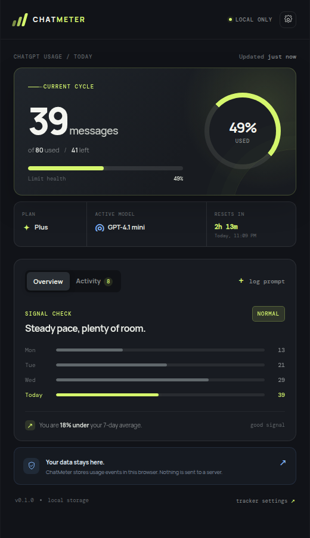

# ChatMeter

> A local-first ChatGPT usage tracker for Chromium browsers.

ChatMeter is a small Chrome/Edge extension I built to keep ChatGPT usage visible while I work. The popup shows a manually recorded account-usage snapshot, its age, any supplied reset time, and a separate best-effort local activity history.



Maintained by [sshnox](https://github.com/sshnox).

## v0.3.1 — prompt-detection reliability

The local activity observer no longer suppresses all messages within one second of a prior message. It now associates a short-lived send gesture with a distinct, newly rendered ChatGPT user-message element, deduplicating DOM re-renders by message identity where available. Two separate rapid sends can be recorded independently.

The observer also handles delayed message text, the initial new-chat-to-conversation navigation, and prevents existing messages, edits to already-observed nodes, and regenerate actions without a send gesture from incrementing the local activity counter. Added browser-event simulation tests covering these scenarios (`npm test`).

**Limitations:** These are browser-observed submissions, not official allowance consumption. DOM changes, attachment-only prompts, sends from other devices, and unsupported chat UI flows may still be missed. No prompt text is stored or transmitted. Usage snapshots remain manually entered, never automatically inferred from observed submissions.

## v0.3 — account-sourced snapshots

ChatMeter does **not** automatically read your official ChatGPT allowance. No supported personal usage API is used. The main meter remains empty until you explicitly enter a percentage from ChatGPT Settings → Usage. Enter a category so different usage pools are not confused, and optionally copy the reset time. Each snapshot is marked as manually supplied with a capture timestamp; it is not a live sync.

If ChatGPT doesn't show a remaining percentage, leave the field empty rather than guessing. Local observed prompts are shown in a separate section, are best-effort only, and are never subtracted from your official snapshot. The app stores data locally, doesn't collect prompt text, and doesn't intercept private endpoints or authentication tokens.

Use **Record snapshot** to open the entry form, **Open ChatGPT** to navigate to the Usage page through ChatGPT settings, **Clear saved snapshot** to erase the manual allowance without deleting history, or **Reset local data** to clear everything. The update retains v0.2 activity records. The README sections below describe older versions; this section describes current usage.

## v0.2 accuracy notes

ChatMeter observes newly rendered ChatGPT user messages following a send action. The heuristic may miss or miscount prompts if ChatGPT changes its DOM, when a send is edited, or when usage occurs on another device. No official usage or account quota API is used.

- Clean initial state: no simulated messages, model, plan, reset timer, or graph history
- Local cycle duration is configurable (default 3 hours) and begins after the first observed prompt
- Message limits are manually configured estimates, not official ChatGPT limits
- Observed prompt counts are not capped at the estimate
- Serial background storage writes reduce lost counts from simultaneous tabs
- Seven-day charts derive from locally observed events; recent activity retains up to 200 records
- v0.1 data is not migrated because it contained indistinguishable demo records
- Reset clears locally stored v0.2 history and sets the counter back to zero

## What it does

- Shows a manually recorded percentage remaining when ChatGPT displays one
- Labels the allowance category; does not infer the active account plan or model
- Keeps the main meter empty unless a user-sourced percentage is supplied
- Shows reset timing only if manually supplied by the user
- Keeps a small activity list of recent prompts and sessions
- Includes Overview and Activity tabs
- Lets you record or clear a snapshot and reset local history
- Runs as a Manifest V3 extension in Chromium browsers
- Includes a local preview so you can try the popup without installing it

## Install from source

ChatMeter is currently distributed as an unpacked developer build.

1. Clone this repository.
2. Run `npm test && npm run build`.
3. Open `chrome://extensions` in Chrome, Edge, Brave, Arc, or another Chromium browser.
4. Turn on **Developer mode**.
5. Choose **Load unpacked** and select the `dist/` directory.
6. Pin ChatMeter, open ChatGPT, and then open the ChatMeter popup.

The `dist/` directory is included for convenience. Run the build command again after changing the source files.

## Local preview

You can preview the popup without installing the extension:

```bash
npm run start
```

Open `http://localhost:3000`. The preview uses `localStorage` because `chrome.storage.local` is only available inside an installed extension. Use **Record snapshot** to enter a percentage copied from ChatGPT Settings → Usage.

## Development commands

```bash
npm run start   # Run the preview on port 3000
npm run check   # Check JavaScript syntax
npm test        # Run local state regressions
npm run build   # Build the unpacked extension into dist/
```

There are no runtime dependencies. The popup uses plain HTML, CSS, and browser JavaScript.

## How it works

The popup and background service worker share one `chatmeter_state_v2` record in `chrome.storage.local`. The content script watches the ChatGPT composer for a send attempt and then checks for a newly rendered user message before sending a small event signal to the service worker. The event contains a timestamp and a count, not the text of the prompt.

When the extension is not installed, the preview uses the same state shape in `localStorage`. The popup listens for storage changes so it can update when a prompt is recorded in another tab.

## Privacy and permissions

ChatMeter stores usage data in the browser and does not have a backend, login, analytics, or API key.

- **Storage:** saves the usage count, activity list, limit, and settings locally.
- **ChatGPT host access:** limited to `https://chatgpt.com/*` and `https://chat.openai.com/*` so prompt submissions can be counted.
- **No prompt text:** the content script sends an event signal only.
- **No network service:** usage data is not sent anywhere.
- **Clear anytime:** use **Reset local data** in settings to remove the local history.

No official live usage API is connected; values on the main meter are user-entered snapshots, not synchronized balances.

## Project layout

```text
.
├── index.html          # Popup UI and settings drawer
├── styles.css          # Popup styles
├── app.js              # Popup state and interactions
├── background.js       # MV3 service worker
├── state.js            # Shared tracking and cycle rules
├── tests/              # State regression tests
├── content.js          # ChatGPT composer event detection
├── manifest.json       # Extension metadata and permissions
├── build.mjs           # Builds the dist/ folder
├── server.mjs          # Local preview server
├── dist/               # Loadable unpacked extension
└── docs/preview.png    # README screenshot
```

## Contributing

Issues and pull requests are welcome. See [CONTRIBUTING.md](CONTRIBUTING.md) before making a change. Please keep the extension local-first, avoid adding permissions without a clear reason, and do not add prompt-content collection.

## License

ChatMeter is released under the [MIT License](LICENSE).
